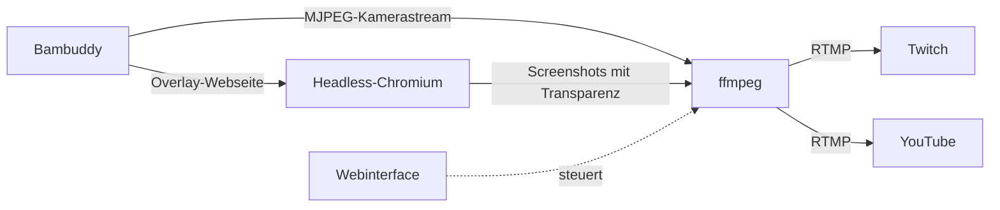

# bambu-buddy-streamer

Streamt das Kamerabild eines Bambu-Lab-Druckers **zusammen mit dem Status-Overlay von Bambuddy** live zu **Twitch** und/oder **YouTube**. Gedacht für einen kleinen Debian-LXC auf Proxmox, Einstellungen und Steuerung laufen über ein passwortgeschütztes Webinterface.

> [!IMPORTANT]
> ## 🙏 Dieses Projekt basiert auf Bambuddy
> **Kamerastream und Overlay stammen aus [Bambuddy](https://github.com/maziggy/bambuddy)**, dem Projekt von **maziggy**. Ohne Bambuddy funktioniert dieses Tool nicht. Ein großes Dankeschön für die Arbeit!
>
> ⭐ **Schau beim Original vorbei und gib dem Projekt einen Stern: [github.com/maziggy/bambuddy](https://github.com/maziggy/bambuddy)**

> [!NOTE]
> **Erstellt mit Claude:** Dieses Projekt (Code, Installer und Dokumentation) wurde in Zusammenarbeit mit **[Claude](https://claude.ai)**, dem KI-Assistenten von Anthropic, entwickelt und vom Maintainer in der eigenen Umgebung getestet. Prüfe den Code vor dem Einsatz wie bei jedem fremden Skript, das mit Root-Rechten läuft.

Inoffizielles Hobbyprojekt: nicht mit Bambu Lab, Twitch oder YouTube verbunden und kein offizieller Teil von Bambuddy.

## Funktionsweise



1. Headless-Chromium öffnet die Overlay-Seite von Bambuddy und macht mehrmals pro Sekunde Screenshots mit transparentem Hintergrund.
2. ffmpeg legt diese Bilder über den Kamerastream von Bambuddy und kodiert das Ergebnis **einmal** (H.264/AAC).
3. Der Stream geht per RTMP an Twitch und/oder YouTube. Fällt ein Ziel aus, läuft das andere weiter.
4. Ein systemd-Dienst startet alles bei Fehlern automatisch neu, auch wenn Bambuddy beim Booten noch nicht erreichbar ist.

## Voraussetzungen

- Proxmox-LXC mit Debian 12 oder neuer, Zugriff als `root`
- Laufende [Bambuddy](https://github.com/maziggy/bambuddy)-Instanz, die vom LXC aus per HTTP erreichbar ist (Kamera-URL und Overlay-URL inklusive Token)
- Stream-Key von Twitch und/oder YouTube
- Internetzugang im LXC (Installation und Streaming)

**Empfohlene LXC-Ressourcen** für 720p bei 15 fps mit CPU-Encoding:

| Ressource | Empfehlung | Minimum |
|---|---|---|
| CPU | 4 Kerne | 2 Kerne |
| RAM | 2 GB | 1,5 GB |
| Swap | 512 MB | – |
| Disk | 8 GB | 6 GB |

Für 1080p etwa 6 Kerne und 3 GB RAM einplanen. Der Upload braucht pro Ziel ungefähr die eingestellte Bitrate (Standard 3,5 Mbit/s).

## Installation

Im LXC als `root`:

```bash
bash <(curl -fsSL https://raw.githubusercontent.com/chrkan/bambu-buddy-streamer/main/install.sh)
```

Fehlt `curl`, vorher `apt-get update && apt-get install -y curl` ausführen.

Wer das Skript vor dem Ausführen lesen möchte:

```bash
curl -fsSL -o install.sh https://raw.githubusercontent.com/chrkan/bambu-buddy-streamer/main/install.sh
less install.sh
bash install.sh
```

Der Installer

- installiert ffmpeg, Python und Chromium (über Playwright) sowie die nötigen Pakete,
- lädt `bambu_twitch.py` und `web.py` direkt von GitHub nach `/opt/bambu-twitch`,
- legt die Config in `/etc/bambu-twitch/config.env` an (nur beim ersten Mal),
- richtet die systemd-Dienste `bambu-twitch` (Stream) und `bambu-twitch-web` (Webinterface) ein,
- erzeugt ein **zufälliges Initialpasswort** und zeigt es am Ende **einmalig** an.

Am Ende der Installation siehst du zum Beispiel:

```
 Webinterface:  http://192.168.178.50:8080
 Initialpasswort: xxxxxxxxxxxxxx
```

## Erste Schritte

1. Webinterface unter `http://<IP-des-LXC>:8080` öffnen und mit dem Initialpasswort anmelden.
2. Ein **eigenes Passwort** vergeben (mindestens 10 Zeichen). Vorher sind alle anderen Seiten gesperrt.
3. Unter **Quellen** die Kamera-URL und die Overlay-URL aus Bambuddy eintragen, z. B.:
   ```
   http://<bambuddy-ip>:8000/api/v1/printers/1/camera/stream?fps=15&token=…
   http://<bambuddy-ip>:8000/overlay/1?show=status%2Cprogress%2Clayers%2Ceta&size=small&token=…
   ```
4. Unter **Ziele** Twitch- und/oder YouTube-Key eintragen.
5. **Speichern & neu starten** klicken, nach 10 bis 20 Sekunden erscheint das Bild bei Twitch/YouTube.
6. Optional **Autostart an** klicken, damit der Stream nach einem Neustart des LXC von selbst läuft.

### Stream-Keys finden

- **Twitch:** Creator-Dashboard → Einstellungen → Stream → *Primärer Stream-Key*
- **YouTube:** YouTube Studio → Live gehen → Streamen → *Streamschlüssel*. Dort den Stream ggf. noch per Klick starten, sofern die automatische Aktivierung aus ist.

Stream-Keys sind wie Passwörter: nicht veröffentlichen und bei Verdacht neu erzeugen.

## Webinterface

| Bereich | Funktion |
|---|---|
| Status | Zustand des Stream-Dienstes, Autostart, Live-Log (aktualisiert alle 3 s, Tokens und Keys sind maskiert) |
| Steuerung | Start, Stop, Neustart, Autostart an/aus |
| Einstellungen | Alle Werte der Config, mit Validierung. Bereits gesetzte Keys werden nie wieder angezeigt |
| Passwort | Ändern unter *Passwort ändern* |

Schutzmaßnahmen: Passwort-Hash statt Klartext, erzwungener Passwortwechsel nach der Installation, Sperre nach 5 Fehlversuchen (5 Minuten), CSRF-Schutz, Sitzung läuft nach 12 Stunden ab.

### Passwort vergessen

```bash
/opt/bambu-twitch/venv/bin/python /opt/bambu-twitch/web.py --reset-password
```

Das setzt ein neues Initialpasswort, das beim nächsten Login wieder geändert werden muss.

## Einstellungen

Alle Werte liegen in `/etc/bambu-twitch/config.env` und lassen sich im Webinterface ändern.

| Variable | Standard | Bedeutung |
|---|---|---|
| `BAMBUDDY_CAMERA_URL` | – | MJPEG-Kamerastream von Bambuddy |
| `BAMBUDDY_OVERLAY_URL` | – | Overlay-Seite von Bambuddy |
| `OVERLAY_CSS` | leer | Zusätzliches CSS für die Overlay-Seite (siehe [Overlay ist nicht transparent](#overlay-ist-nicht-transparent)) |
| `TWITCH_ENABLED` / `YOUTUBE_ENABLED` | `1` | Ziel ein- oder ausschalten |
| `TWITCH_STREAM_KEY` / `YOUTUBE_STREAM_KEY` | leer | Stream-Keys |
| `WIDTH` / `HEIGHT` | `1280` / `720` | Auflösung des Streams |
| `FPS` | `15` | Bilder pro Sekunde (die Bambuddy-Kamera liefert 15) |
| `OVERLAY_FPS` | `5` | Aktualisierungen des Overlays pro Sekunde |
| `VIDEO_BITRATE` | `3500k` | Video-Bitrate, Twitch erlaubt maximal ca. 6000k |
| `X264_PRESET` | `veryfast` | Encoder-Preset, schneller = weniger CPU |
| `SILENT_AUDIO` | `1` | Stille Tonspur einmischen (Twitch verlangt Audio) |
| `TWITCH_INGEST` | `rtmp://live.twitch.tv/app` | Twitch-Ingest-Server |
| `YOUTUBE_INGEST` | `rtmp://a.rtmp.youtube.com/live2` | YouTube-Ingest-Server |
| `RETRY_DELAY` | `10` | Sekunden bis zum Neustart nach einem Fehler |

Nur für die Fehlersuche (in `config.env` von Hand ergänzen):

| Variable | Bedeutung |
|---|---|
| `OUTPUT_URL` | Datei statt Twitch/YouTube, z. B. `/tmp/test.flv` (schreibt 20 Sekunden) |
| `FFMPEG_LOGLEVEL` | z. B. `info` |
| `STATS` | `1` zeigt ffmpeg-Statistiken (`speed=`, `fps=`) |

## Update

Den Installer einfach erneut ausführen. Config, Stream-Keys und Passwort bleiben erhalten.

```bash
bash <(curl -fsSL https://raw.githubusercontent.com/chrkan/bambu-buddy-streamer/main/install.sh)
```

Ein laufender Stream wird dabei **nicht** unterbrochen. Zum Laden der neuen Version im Webinterface auf *Neustart* klicken. Einen anderen Branch lädst du mit `BRANCH=name bash <(curl …)`.

## Deinstallation

```bash
bash <(curl -fsSL https://raw.githubusercontent.com/chrkan/bambu-buddy-streamer/main/install.sh) --uninstall
```

Mit `--uninstall --purge` werden zusätzlich Config, Keys und Passwort gelöscht.

## Fehlersuche

Logs ansehen:

```bash
journalctl -u bambu-twitch -f        # Stream
journalctl -u bambu-twitch-web -f    # Webinterface
```

### `401 Unauthorized` beim Öffnen der Kamera

Der Token in der Kamera-URL stimmt nicht. Kamera und Overlay haben in Bambuddy unterschiedliche Tokens, prüfe, dass nicht der falsche in die Kamera-URL kopiert wurde. Test:

```bash
curl -s -o /dev/null -w "%{http_code}\n" --max-time 5 "<KAMERA-URL>"
```

Es sollte `200` kommen. `curl -I` liefert `405`, das ist normal, der Endpunkt erlaubt nur GET.

### Twitch/YouTube zeigen „Loading…“ oder ein schwarzes Bild

„Live“ heißt nur, dass die Verbindung steht. Testen, was tatsächlich kodiert wird:

```bash
systemctl stop bambu-twitch
set -a; . /etc/bambu-twitch/config.env; set +a
OUTPUT_URL=/tmp/test.flv STATS=1 FFMPEG_LOGLEVEL=info \
  /opt/bambu-twitch/venv/bin/python /opt/bambu-twitch/bambu_twitch.py
```

Ein einzelnes Bild daraus: `ffmpeg -ss 5 -i /tmp/test.flv -frames:v 1 /tmp/out.png`. Eine Bitrate von nur wenigen kbit/s bedeutet, dass praktisch kein Bildinhalt kodiert wird. Meist ist dann das Overlay deckend (siehe nächster Punkt) oder die Overlay-Seite bleibt auf einem Ladebildschirm hängen (Token des Overlays prüfen).

### Overlay ist nicht transparent

Hat die Overlay-Seite einen eigenen Hintergrund, verdeckt sie die Kamera. Welche Elemente das sind, zeigt dieses Diagnoseskript:

<details>
<summary>Diagnoseskript anzeigen</summary>

```bash
set -a; . /etc/bambu-twitch/config.env; set +a
/opt/bambu-twitch/venv/bin/python - <<'EOF'
import os, asyncio
from playwright.async_api import async_playwright
JS = """
() => {
  const out = [];
  for (const el of document.querySelectorAll('html, body, body *')) {
    const r = el.getBoundingClientRect();
    if (r.width < innerWidth*0.9 || r.height < innerHeight*0.9) continue;
    const bg = getComputedStyle(el).backgroundColor;
    if (bg !== 'rgba(0, 0, 0, 0)' && bg !== 'transparent')
      out.push(el.tagName + (el.id ? '#'+el.id : '') + (el.className ? '.'+String(el.className).split(' ').join('.') : '') + '  ' + bg);
  }
  return out;
}
"""
async def main():
    async with async_playwright() as pw:
        b = await pw.chromium.launch(args=["--no-sandbox","--disable-gpu","--disable-dev-shm-usage"])
        p = await b.new_page(viewport={"width":1280,"height":720})
        await p.goto(os.environ["BAMBUDDY_OVERLAY_URL"], wait_until="domcontentloaded")
        await p.add_style_tag(content="html,body{background:transparent!important}")
        await p.wait_for_timeout(5000)
        for line in await p.evaluate(JS): print("BG:", line)
        await b.close()
asyncio.run(main())
EOF
```

</details>

Erscheint dort z. B. `DIV.min-h-screen.bg-black  rgb(0, 0, 0)`, trage im Webinterface unter *Zusatz-CSS für das Overlay* ein:

```css
.min-h-screen.bg-black{background:transparent!important}
```

Ist das Overlay danach auf hellen Bildern schlecht lesbar, hilft ein leichter Schleier, z. B. `.min-h-screen.bg-black{background:rgba(0,0,0,0.25)!important}`.

### `Network is unreachable` nach dem Booten

Der Stream-Dienst wartet beim Start bis zu zwei Minuten, bis der Host aus der Kamera-URL erreichbar ist, und startet danach selbst. Kommt Bambuddy später hoch, reicht das meist aus. Sonst Netzwerk und Firewall zwischen den beiden LXCs prüfen (Port 8000 muss offen sein).

### Ruckeln oder `speed` unter 1x

Der LXC hat zu wenig CPU. Mögliche Maßnahmen: mehr Kerne zuweisen, `OVERLAY_FPS` auf 2 senken, `X264_PRESET` auf `superfast` oder die Auflösung verringern.

### Warnung `deprecated pixel format used`

Harmlos. Sie stammt vom Farbbereich der MJPEG-Kamera und wird beim Öffnen des Streams einmalig ausgegeben.

## Sicherheit

- Das Webinterface spricht **HTTP ohne Verschlüsselung** (Port 8080). Nur im vertrauenswürdigen LAN betreiben, nicht ins Internet freigeben. Für Zugriff von außen ein VPN oder einen Reverse Proxy mit TLS davorsetzen.
- Der Webdienst läuft als `root`, weil er den Stream-Dienst per systemd steuert. Eine Einschränkung per Proxmox-Firewall auf Port 8080 ist empfehlenswert.
- `/etc/bambu-twitch/` ist nur für `root` lesbar (Config, Passwort-Hash und Session-Schlüssel).
- Tokens und Stream-Keys gehören nicht ins Git-Repository und nicht in Issues oder Logs, die du veröffentlichst.

## Dateien

| Datei | Zweck |
|---|---|
| `install.sh` | Installer, Updater und Deinstaller |
| `bambu_twitch.py` | Stream-Dienst: Overlay rendern, ffmpeg starten, Neustart bei Fehlern |
| `web.py` | Webinterface mit Login |

Auf dem LXC:

| Pfad | Inhalt |
|---|---|
| `/opt/bambu-twitch/` | Programmdateien und Python-Umgebung |
| `/etc/bambu-twitch/config.env` | Einstellungen |
| `/etc/bambu-twitch/web.json` | Passwort-Hash |
| `/etc/systemd/system/bambu-twitch*.service` | systemd-Dienste |

## Danksagung

- **[Bambuddy](https://github.com/maziggy/bambuddy) von maziggy**: liefert den Kamerastream und das Overlay, auf denen dieses Projekt aufbaut.
- **[Claude](https://claude.ai) von Anthropic**: Unterstützung bei Entwicklung und Dokumentation.
- Eingesetzte Software: [ffmpeg](https://ffmpeg.org), [Playwright](https://playwright.dev) mit Chromium, [Flask](https://flask.palletsprojects.com) und [Waitress](https://docs.pylonsproject.org/projects/waitress/).

## Entwicklung

Aus einem lokalen Checkout installieren, ohne von GitHub zu laden:

```bash
git clone https://github.com/chrkan/bambu-buddy-streamer.git
cd bambu-buddy-streamer
bash install.sh --local
```
